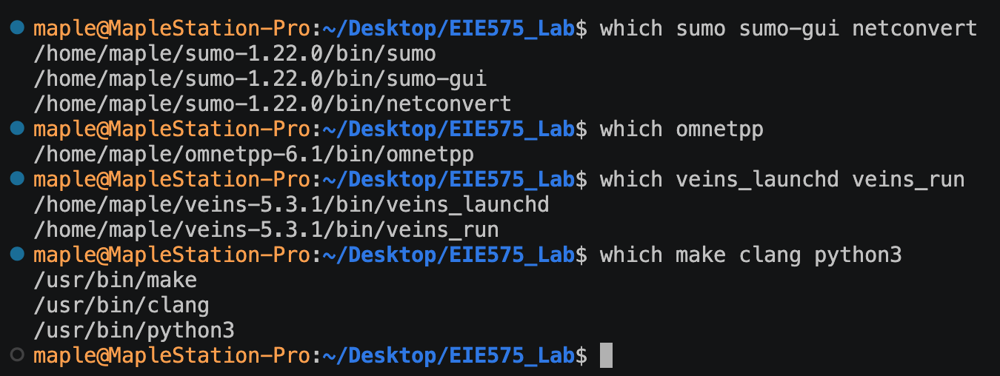
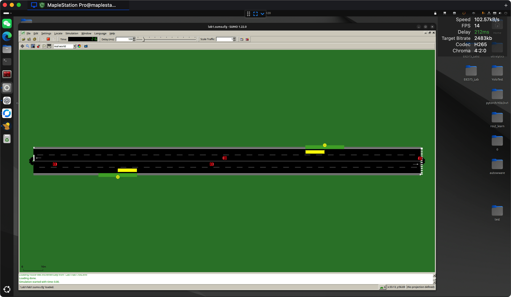
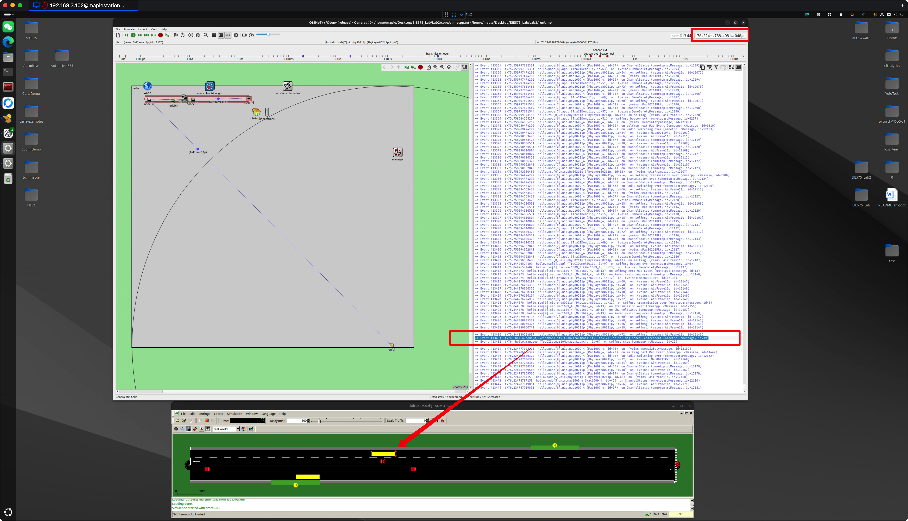
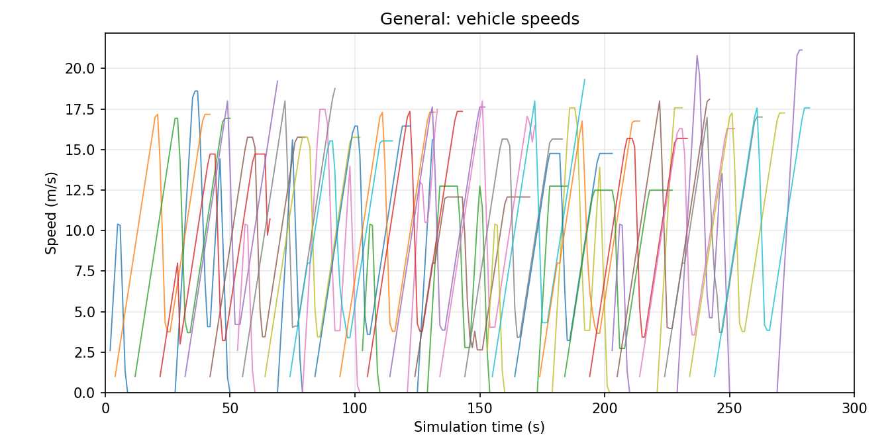
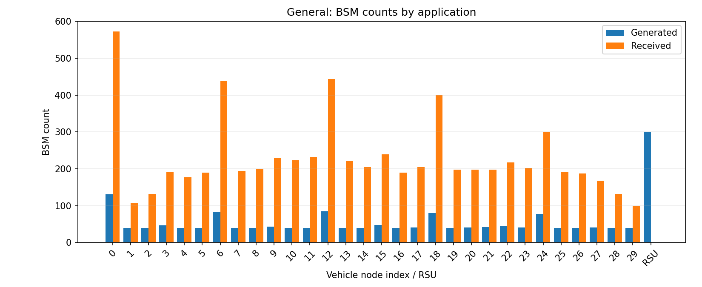
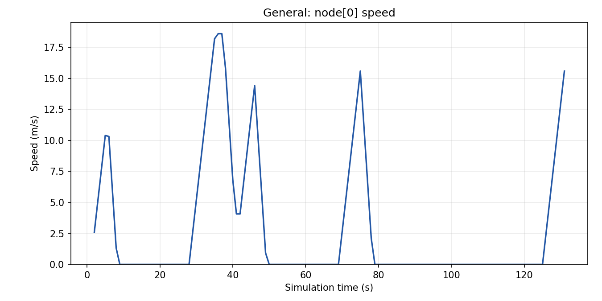
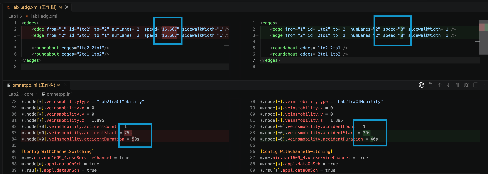
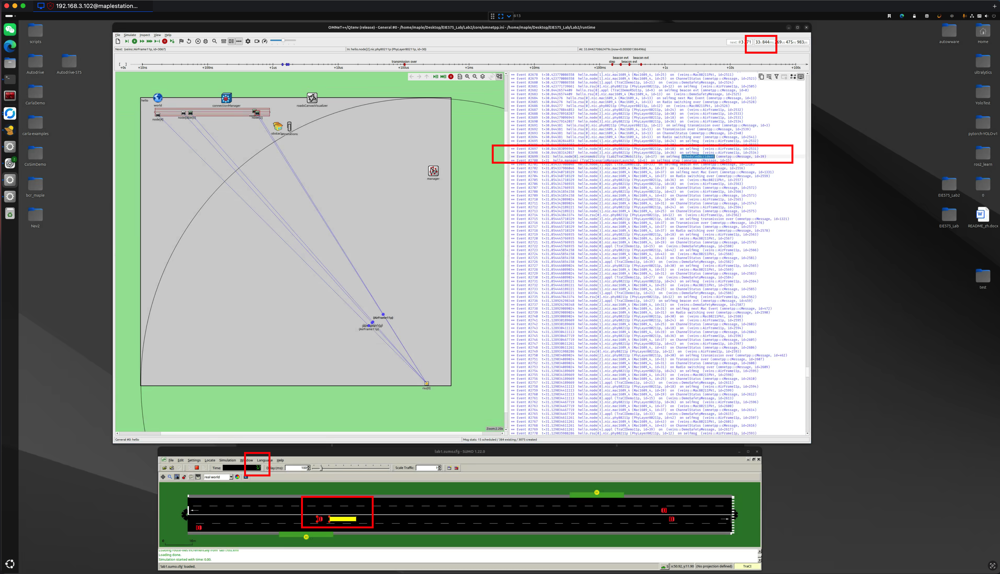

**Declaration of AI: The core source files were understood with the assistance of ChatGPT, and the code was made compatible with Linux with the assistance of Codex.**

Student: WU Dihang     
Student ID: 26040407g

This experiment refers to the tutorial PDFs, but the environment was replaced from Windows to Linux after completing the experiment in class, and minor modifications were made.

## The Development Environment

| Tools | Version | Local Path |
|---|---|---|
| sumo | 1.22.0 | `/home/maple/sumo-1.22.0/bin/sumo` |
| sumo-gui | 1.22.0 | `/home/maple/sumo-1.22.0/bin/sumo-gui` |
| netconvert | 1.22.0 | `/home/maple/sumo-1.22.0/bin/netconvert` |
| omnetpp | 6.1 | `/home/maple/omnetpp-6.1/bin/omnetpp` |
| veins_launchd | 5.3.1  | `/home/maple/veins-5.3.1/bin/veins_launchd` |
| veins_run | 5.3.1  | `/home/maple/veins-5.3.1/bin/veins_run` |
| make(GNU) | 4.3 | `/usr/bin/make` |
| clang | 18.1.3 | `/usr/bin/clang` |
| python3 | 3.12.3 | `/usr/bin/python3` |



## Lab1
The Lab1 simulates a SUMO road traffic scenario, including:
* Road network: A bidirectional road between two nodes, with two traffic lanes in each direction, sidewalks, and a pedestrian crossing.
* Bus stop: Two bus stops, where buses stop for 20 seconds at each stop.
* Vehicle generation: 5 buses and 25 NPC cars, with cars entering the road in batches at 10-second intervals.
* Route configuration: Vehicles follow predefined routes and exhibit traffic behaviours such as acceleration, deceleration, stopping at bus stops, and car-following.
* The road network is generated using netconvert, and the simulation runs for 300 seconds of simulation time in SUMO. Vehicle movements can be observed through the sumo-gui.

### Project Files

| Project Files | Function |
|---|---|
| `lab1.nod.xml` | Defines the road nodes and their coordinates. |
| `lab1.edg.xml` | Defines the roads, lane counts, speed limits, sidewalks, and roundabout declarations. |
| `lab1.conn.xml` | Defines the pedestrian crossing and its priority. |
| `lab1.net.xml` | Stores the complete road network automatically generated by `netconvert`. |
| `lab1.add.xml` | Defines the bus stops and their positions on the lanes. |
| `lab1.rou.xml` | Defines vehicle types, routes, departure schedules, traffic flows, and stopping durations. |
| `lab1.sumo.cfg` | Specifies the simulation input files, start and end times, and logging settings. |
| `lab1.sumo_gui_settings.xml` | Selects the `real world` visualization scheme for SUMO GUI. |

#### `lab1.nod.xml`
* This is a confg file to describe the 2 nodes (of the road)
    ```xml
    <nodes>
        <node id="1" x="-150.0" y="0.0" />
        <node id="2" x="+50.0" y="0.0" />
    </nodes>
    ```
    * `id` `1` and `2` : the name of 2 nodes respectively
    *  `x`,`y` : the coordinate of 2 nodes

#### `lab1.edg.xml`
* This config file describes the road that connects the nodes.
    ```xml
    <edges>
        <edge from="1" id="1to2" to="2" numLanes="2" speed="16.667" sidewalkWidth="1"/>
        <edge from="2" id="2to1" to="1" numLanes="2" speed="16.667" sidewalkWidth="1"/>

        <roundabout edges="1to2 2to1"/>
        <roundabout edges="2to1 1to2"/>
    </edges>
    ```
    * `"1to2"` and `"2to1"` : name the 2 roads of 2 directions respectively
    * `numLanes="2"` : each road possesses 2 lanes
    * `speed="16.667"` : the speed limit of both 2 road is 16.667 m/s
    * `sidewalkWidth="1"` : add the sidewalk with width 2m
    * `<roundabout edges="1to2 2to1"/>` : define the `"edges"` as roundabout
        * Two definitions of roundabout are duplicated; one of them can be deleted.

#### `lab1.conn.xml`
* This config file describes the crossing across the road
    ```xml
        <connections>
            <crossing node="2" edges="1to2 2to1" priority="true" width="1"/>
        </connections>
    ```
    * `node="2"` : there is a crossing at node and it connects the 2 roads of 2 directions
    * `edges="1to2 2to1"` : cross these 2 road
    * `priority="true"` : give priority to pedestrian
    * `width="1"` = 1m


#### `lab1.net.xml`
* This is the complete road network file generated by `netconvert` from `lab1.nod.xml`, `lab1.edg.xml`, and `lab1.conn.xml`, and include these 3 config files's information, which can be directly load by SUMO.
    ```shell
    cd Lab1
    netconvert --node-files=lab1.nod.xml --edge-files=lab1.edg.xml --connection-files=lab1.conn.xml --output-file=lab1.net.xml
    ```

#### `lab1.add.xml`
* This config file describes the positions of the two bus stops.
    ```xml
    <additional>
        <busStop id="1" lane="1to2_1" startPos="33.57" endPos="53.57" lines="1_1"/>
        <busStop id="2" lane="2to1_1" startPos="39.58" endPos="59.58" lines="1_2"/>
    </additional>
    ```
    * `id` : the name of each bus stop.
    * `lane` : the bus stop is located on which lane, The two stops are on opposite directions of the road.
    * `startPos` and `endPos` : the beginning and end of the stop area, measured in meters along the lane from its starting point.
        * Stop 1 extends from 33.57m to 53.57m, and stop 2 extends from 39.58m to 59.58m. Both stop areas are 20m long.
    * `lines` : the bus line labels displayed for the stops.

#### `lab1.rou.xml`
* This config file defines the vehicle types, routes, individual buses, and NPC car flows.
* The first part defines two vehicle types.
    ```xml
    <vType id="1" accel="2.6" decel="4.5" sigma="0" length="10" minGap="3" maxSpeed="60" color="1,1,0" guiShape="bus"/>
    <vType id="2" accel="1.0" decel="5.0" sigma="0.0" length="2.0" maxSpeed="100.0" color="1,0,0" />
    ```
    * `id="1"` is used for the buses, and `id="2"` is used for the NPC cars.
    * `accel` : the acceleration parameter, in m/s². It is 2.6 for the buses and 1.0 for the NPC cars.
    * `decel` : the normal deceleration parameter, in m/s². It is 4.5 for the buses and 5.0 for the NPC cars.
    * `sigma="0"` : set the driver imperfection parameter of the default car-following model to zero. 
    * `length` : the vehicle length, in metres. The bus is 10m long, while the NPC car is 2m long.
    * `minGap="3"` : set the bus's minimum gap at standstill to 3m.
    * `maxSpeed` : the vehicle's own maximum speed parameter, in m/s. The values 60 and 100 are not the speeds that vehicles must maintain. 
    * `color="1,1,0"` gives a yellow colour, while `color="1,0,0"` gives a red colour. 
    * `guiShape="bus"` : display the vehicle using the bus shape.

* The next part defines the shared route of the buses.
    ```xml
    <route id="route0" edges="1to2 2to1">
        <stop busStop="1" duration="20"/>
        <stop busStop="2" duration="20"/>
    </route>
    ```
    * `id="route0"` : the name used when a bus refers to this route.
    * `edges="1to2 2to1"` : first travel from node 1 to node 2, then return from node 2 to node 1.
    * `busStop="1"` and `busStop="2"` refer to the stops defined in `lab1.add.xml`.
    * `duration="20"` : stop at each bus stop for 20 seconds of simulation time.
    * A vehicle leaves the simulation after completing its route. The roundabout declaration does not make the route repeat indefinitely.

* The five buses are defined by the following `vehicle` elements from `Lab1/lab1.rou.xml`:

    ```xml
    <vehicle id="KMB_1" color="1,1,0" route="route0" depart="0" type="1"/>
    <vehicle id="KMB_2" color="1,1,0" route="route0" depart="51" type="1"/>
    <vehicle id="KMB_3" color="1,1,0" route="route0" depart="101" type="1"/>
    <vehicle id="KMB_4" color="1,1,0" route="route0" depart="151" type="1"/>
    <vehicle id="KMB_5" color="1,1,0" route="route0" depart="201" type="1"/>
    ```

    * `id` : identify each bus, from `KMB_1` to `KMB_5`.
    * `route="route0"` : use the shared bus route and its stopping instructions.
    * `depart` : specify the scheduled departure time in simulation seconds.
    * `type="1"` : use the parameters of vehicle type 1.

* NPC cars are generated by the following five `flow` elements extracted from the same source file:

    ```xml
    <flow id="car_route" color="1,0,0"  begin="0" end="50" period="10" type="2">
        <route edges="1to2 2to1"/>
    </flow>
    <flow id="car_route1" color="1,0,0" begin="52" end= "100" period="10" type="2">
        <route edges="1to2 2to1"/>
    </flow>
    <flow id="car_route2" color="1,0,0" begin="102" end="150" period="10" type="2">
        <route edges="1to2 2to1"/>
    </flow>
    <flow id="car_route3" color="1,0,0" begin="152" end="200" period="10" type="2">
        <route edges="1to2 2to1"/>
    </flow>
    <flow id="car_route4" color="1,0,0" begin="202" end="250" period="10" type="2">
        <route edges="1to2 2to1"/>
    </flow>
    ```

    * `begin` : the scheduled departure time of the first car in each flow.
    * `end` : the end of the departure interval; this time is excluded.
    * `period="10"` : schedule one car every 10 seconds within that interval.
    * `type="2"` : use the NPC car type.
    * Each flow contains its own `<route edges="1to2 2to1"/>`. The cars follow both road directions without the bus stopping instructions.
    * For example, `car_route` has `begin="0"`, `end="50"`, and `period="10"`, so its scheduled departure times are 0, 10, 20, 30, and 40 seconds.

* The five `vehicle` elements create 5 buses. Each of the five `flow` elements schedules 5 NPC cars, giving 25 NPC cars and 30 vehicles in total. A scheduled departure may be delayed if there is insufficient space to insert the vehicle safely.

#### `lab1.sumo.cfg`
* This is the main configuration file loaded when SUMO starts.
    ```xml
    <configuration>
        <input>
            <net-file value="lab1.net.xml"/>
            <route-files value="lab1.rou.xml"/>
            <additional-files value="lab1.add.xml"/>
        </input>
        <time>
            <begin value="0"/>
            <end value="300"/>
        </time>
        <report>
            <no-step-log value="true"/>
        </report>
    </configuration>
    ```
    * `net-file` : load the generated road network.
    * `route-files` : load the vehicle types, routes, and departure schedules.
    * `additional-files` : load the bus stops.
    * The relative input paths are resolved from the directory containing this configuration file, which is `Lab1/`.
    * `begin="0"` and `end="300"` : run from 0s to 300s of simulation time. This is different from the time spent waiting in the real world.
    * `no-step-log="true"` : suppress the regular step-by-step progress messages in the terminal.

#### `lab1.sumo_gui_settings.xml`
* This is an additional display configuration
    ```xml
    <viewsettings>
        <scheme name="real world"/>
    </viewsettings>
    ```
    * The `real world` scheme changes the appearance of the roads, vehicles, and background.
    * It does not make simulation time equal to real time or change the traffic model.
    * The file is loaded by the `--gui-settings-file` argument in `Lab1/Makefile`.

### Run Lab1 on Linux

Run from the project root directory. To observe the traffic in SUMO GUI:

```shell
make -C Lab1 lab1-sumo-gui
```

Click the SUMO run button to start. This command automatically generates the road network if needed. To run without a graphical window, use `make -C Lab1 lab1-sumo` instead. Use `make -C Lab1 lab1-netconvert` when you only want to generate or update the network.

* The GUI command used by the Makefile is:
    ```shell
    cd Lab1
    sumo-gui -c lab1.sumo.cfg --gui-settings-file lab1.sumo_gui_settings.xml --delay 100
    ```
    * `-c` : specify the main simulation configuration.
    * `--gui-settings-file` : specify the display configuration.
    * `--delay 100` : add a delay of 100ms between simulation steps to make vehicle movement easier to observe.
* The execution sequence is: generate or reuse the network, load the simulation configuration and its inputs, insert vehicles according to their schedules, update their movement and stops, and finish at the configured simulation end time.

### The capture of Lab1


## Lab2

The Lab2 simulates a vehicule communication scenario using OMNeT++, Veins, and the SUMO road traffic from Lab1, including:
* Communication Network: A network named `hello`, with vehicle nodes managed by Veins and one road-side unit (RSU).
* Traffic synchronization: OMNeT++ communicates with SUMO through TraCI to dispense the positions and movements of the vehicles.
* Wireless communication: Vehicles and the RSU use IEEE 802.11p PHY and IEEE 1609.4 MAC models, with periodic basic safety messages (BSMs).
* Accident: a bus is instructed to stop to simulate an accident in 75s（simulation time）.
* Simulation: The simulation runs for up to 300 seconds of simulation time, with a separate configuration for channel switching(default `General` without channel switching).

### Project Files

| Project Files | Function |
|---|---|
| `Lab2/core/package.ned` | Defines the name of NED(Network Description) package. |
| `Lab2/core/lab2.ned` | Defines the network named `hello` and adds one RSU to the Veins scenario. |
| `Lab2/core/omnetpp.ini` | Defines the OMNeT++ simulation and vehicular communication settings. |
| `Lab2/core/lab2.launchd.xml` | declare the path of the SUMO files used when the traffic simulation is launched. |
| `Lab2/core/config.xml` | Defines the models of communication. |
| `support/` | additional supportive sources for running Lab2 in the Linux environment. |

#### `package.ned`
* This file defines the package name used by the NED files.
    ```ned
    package org.car2x.veins;
    ```
    * `package` : declare the package name of the NED.
    * `org.car2x.veins` : the package name of network. It is also used in `omnetpp.ini`.

#### `lab2.ned`
* This file defines the simulation network by inheriting the existing Veins scenario.
    ```ned
    package org.car2x.veins;

    import org.car2x.veins.nodes.RSU;
    import org.car2x.veins.nodes.Scenario;

    network hello extends Scenario
    {
        submodules:
            rsu[1]: RSU
            {
                @display("p=150,140;i=veins/sign/yellowdiamond;is=vs;r=500");
            }
    }
    ```
    * `import xxx` : make the existing modules `RSU` and `Scenario` types available in this file.
    * `network hello extends Scenario` : name a network `hello` from Veins and inherit it's factors, and full name is `org.car2x.veins.hello`.
    * `submodules` : add a sub-modules contained in this network.
    * `rsu[1]: RSU` : create an array of RSUs containing 1 RSU (index is `rsu[0]`)
    * `@display` : configure how the RSU is displayed in OMNeT++
        * `p=150,140` : the coordinate position of the RSU icon.
        * `i=veins/sign/yellowdiamond` and `is=vs` : set the icon and its size.
        * `r=500` : draw a 500 radius circle of the radio communication range.
    * The real RSU coordinates are defined in `omnetpp.ini`.

#### `omnetpp.ini`
* This is the main config file for OMNeT++
* The first part selects the network and configures terminal progress messages.
    ```ini
    [General]
    cmdenv-express-mode = true
    cmdenv-autoflush = true
    cmdenv-status-frequency = 1s
    **.cmdenv-log-level = info

    network = org.car2x.veins.hello
    ```
    * `[General]` : define the common(general) settings of omnetpp.
    * `cmdenv-express-mode = true` : reduce detailed output in the command-line simulation with express-mode.
    * `cmdenv-autoflush = true` : flush command-line output automatically.
    * `cmdenv-status-frequency = 1s` : update the status every 1 second（simulation time）.
    * `**.cmdenv-log-level = info` : set the `log` level = info
    * `network` : select the network declared in `lab2.ned`

* The `Simulation parameters` part defines the simulation duration, result recording, and omnetpp's simulation area dimensions.
    ```ini
    debug-on-errors = false
    print-undisposed = false
    sim-time-limit = 300s

    **.scalar-recording = true
    **.vector-recording = true

    *.playgroundSizeX = 500m
    *.playgroundSizeY = 500m
    *.playgroundSizeZ = 50m
    *.annotations.draw = true
    ```
    * `debug-on-errors = false` : let the debugger don't break when simulation errors occur. Errors can stop the simulation
    * `print-undisposed = false` : disable the report of left undisposed objects when the simulation finishes.
    * `sim-time-limit = 300s` : limit the simulation time of 300 seconds(simulation time).
    * `scalar-recording` : enable recording of results, such as message count.
    * `vector-recording` : enable recording the result with time, such as vehicle speed at different simulation times.
    * `playgroundSizeX`, `playgroundSizeY`, and `playgroundSizeZ`: define the size of the Omnetpp‘s simulation area as longitude=500m, with=500m, and height=50m. 
        * These settings do not influence the SUMO roads.
    * `annotations.draw = true` : enable the visualization in omnetpp, for example the line between two communication nodes.

* The ``TraCI` define how OMNeT++ connects to the SUMO in the same computer.
    ```ini
    *.manager.updateInterval = 1s
    *.manager.host = "localhost"
    *.manager.port = 9999
    *.manager.autoShutdown = true
    *.manager.launchConfig = xmldoc("lab2.launchd.xml")
    ```
    * `updateInterval = 1s` : syncronize the simulation every 1s.
    * `host = "localhost"` : connects to the proxy on the same computer.
    * `port = 9999` : use port 9999 for the proxy connection.
    * `autoShutdown = true` : allow the simulation to be stopped when SUMO reports that there won't be any traffic simulation remaining.
    * `launchConfig` : load the XML launch instructions from `./lab2.launchd.xml`

* The `RSU settings` define its position and other parameters.
    ```ini
    *.rsu[0].mobility.x = 500
    *.rsu[0].mobility.y = 500
    *.rsu[0].mobility.z = 3

    *.rsu[*].applType = "TraCIDemoRSU11p"
    *.rsu[*].appl.headerLength = 80 bit
    *.rsu[*].appl.sendBeacons = true
    *.rsu[*].appl.dataOnSch = false
    *.rsu[*].appl.beaconInterval = 1s
    *.rsu[*].appl.beaconUserPriority = 7
    *.rsu[*].appl.dataUserPriority = 5
    ```
    * `rsu[0].mobility.x`, `y`, and `z` : the coordinate of rsu[0]; rsu[*] means funtions to all the rsu
    * `applType = "TraCIDemoRSU11p"` : use the Veins' RSU application, which could relay received traffic messages.
    * `headerLength = 80 bit` : set the header length to 80 bits.
    * `sendBeacons = true` : enable periodic beacon messages (BSMs).
    * `dataOnSch = false` : send data on the control channel (CCH), instead of service channel (SCH).
    * `beaconInterval = 1s` : set the beacon interval to 1 second(simulation time).
    * `beaconUserPriority = 7` and `dataUserPriority = 5` : set the priorities for beacon and data messages. 


* The `connection manager` control how wireless transmissions are delivered between modules.
    ```ini
    *.connectionManager.sendDirect = true
    *.connectionManager.maxInterfDist = 2600m
    *.connectionManager.drawMaxIntfDist = false
    ```
    * `sendDirect = true` : allow messages transmitted directly between the simulation modules.
    * `maxInterfDist = 2600m` : set the maximum interference distance
    * `drawMaxIntfDist = false` : do not draw the maximum interference distance in the GUI.


* The `IEEE 1609.4 MAC` define channel use, transmit power, and bitrate.
    ```ini
    *.**.nic.mac1609_4.useServiceChannel = false
    *.**.nic.mac1609_4.txPower = 20mW
    *.**.nic.mac1609_4.bitrate = 6Mbps
    ```
    * `useServiceChannel = false` : disable switching between the control channel and service channel
    * `txPower = 20mW` : set the radio transmit power to 20 million watts.
    * `bitrate = 6Mbps` : set the transmission bitrate to 6 megabits per second.
    * `*.**.nic` : applies these settings to all the communication units(vehicles and the RSU).


* The `IEEE 802.11p PHY` define background noise, radio models.
    ```ini
    *.**.nic.phy80211p.minPowerLevel = -89dBm
    *.**.nic.phy80211p.useNoiseFloor = true
    *.**.nic.phy80211p.noiseFloor = -110dBm
    *.**.nic.phy80211p.decider = xmldoc("config.xml")
    *.**.nic.phy80211p.analogueModels = xmldoc("config.xml")
    *.**.nic.phy80211p.usePropagationDelay = true
    ```
    * `minPowerLevel = -89dBm` : set the minimum received power used by the PHY reception model. 
    * `useNoiseFloor = true` and `noiseFloor = -110dBm` : enbale a background noise of -110dBm.
    * `decider` :  from `config.xml` to get a reception decision model
    * `analogueModels` : from `config.xml` to get the signal propagation models
    * `usePropagationDelay = true` : consider the time required for radio signals between nodes.

* The `vehicle application`  enable the Veins demonstration application and periodic beacons.
    ```ini
    *.node[*].applType = "TraCIDemo11p"
    *.node[*].appl.headerLength = 80 bit
    *.node[*].appl.sendBeacons = true
    *.node[*].appl.dataOnSch = false
    *.node[*].appl.beaconInterval = 1s
    ```
    * `node[*]` : apply the settings to all vehicle nodes created.
    * `applType = "TraCIDemo11p"` : generate traffic warnings when vehicles remain stopped.
    * `headerLength = 80 bit` : set the header length of 80 bits.
    * `sendBeacons = true` and `beaconInterval = 1s` : enable BSMs with a nominal one-second interval.
    * `beaconInterval = 1s` : set the beacon interval to 1 second(simulation time).

* The `mobility settings` select the vehicle mobility module and configure scheduled accidents.
    ```ini
    *.node[*].veinsmobilityType = "Lab2TraCIMobility"
    *.node[*].veinsmobility.x = 0
    *.node[*].veinsmobility.y = 0
    *.node[*].veinsmobility.z = 1.895
    *.node[*0].veinsmobility.accidentCount = 1
    *.node[*0].veinsmobility.accidentStart = 75s
    *.node[*0].veinsmobility.accidentDuration = 50s
    ```
    * `veinsmobilityType = "Lab2TraCIMobility"` : use local Lab2TraCIMobility as veinsmobilityType
        * Lab2TraCIMobility is defined in support/
    * `x = 0` and `y = 0` : innitial values, actual vehicle positions are updated through TraCI from SUMO.
    * `z = 1.895` : set the vehicle mobility height to 1.895m.
    * `node[*0]` : match vehicle indices ending in `0`, such as `node[0]`, `node[10]`, and `node[20]`.
    * `accidentCount = 1` : schedule one accident for each matching vehicle.
    * `accidentStart = 75s` : schedule when the accident start
    * `accidentDuration = 50s` : schedule  the duration of accident

* The last part defines an alternative configuration with channel switching.
    ```ini
    [Config WithChannelSwitching]
    *.**.nic.mac1609_4.useServiceChannel = true
    *.node[*].appl.dataOnSch = true
    *.rsu[*].appl.dataOnSch = true
    ```
    * `[Config WithChannelSwitching]` : create a configuration that inherits the common settings from `[General]` named 'WithChannelSwitching'.
    * `useServiceChannel = true` : enable MAC switching between the control channel and service channel.
    * `dataOnSch = true` : send vehicle and RSU application data on a service channel. Beacons remain on the control channel.
    * The other simulation, traffic, and radio settings remain same inherited from `[General]`.

#### `lab2.launchd.xml`
* This file specifies the paths of SUMO config files.
    ```xml
    <launch>
        <basedir path="../../Lab1"/>
        <copy file="lab1.net.xml"/>
        <copy file="lab1.rou.xml"/>
        <copy file="lab1.add.xml"/>
        <copy file="lab1.sumo.cfg" type="config"/>
    </launch>
    ```
    * `<launch>` : key word of paprmeter, means this part is send to the SUMO proxy for launching.
    * `basedir` : a base path for files
    * `<copy>` : copy each required file into the temporary directory used for SUMO.
    * `lab1.net.xml` `lab1.rou.xml` `lab1.add.xml` : road config files reused from Lab1
    * `lab1.sumo.cfg` and `type="config"` : indicate the main SUMO configuration file.
    * Lab2 reuses the Lab1 traffic inputs rather than defining a new road network.

#### `config.xml`
* This file defines the radio propagation and reception models referenced by `omnetpp.ini`.
    ```xml
    <root>
        <AnalogueModels>
            <AnalogueModel type="SimplePathlossModel">
                <parameter name="alpha" type="double" value="2.0"/>
            </AnalogueModel>
        </AnalogueModels>
        <Decider type="Decider80211p">
            <!-- The center frequency on which the phy listens -->
            <parameter name="centerFrequency" type="double" value="5.890e9"/>
        </Decider>
    </root>
    ```
    * `<root>` : key word for omnet
    * `<AnalogueModels>` :  the models applied to transmitted radio signals.
    * `type="SimplePathlossModel"` : use a distance-based signal attenuation model.
    * `alpha` : the path-loss exponent. With `value="2.0"`, received power decreases approximately with the square of distance
    * `type="double"` : interpret the parameter value as a double floating-point number.
    * `<Decider type="Decider80211p">` : choose the decider type
    * `centerFrequency = 5.890e9` : set the listening center frequency to 5.890 billion hertz(5.89GHz).

#### `support/`

| File or Directory | Function |
|---|---|
| `compat/` | Contains compatibility code for recording vehicle data with the local Veins and OMNeT++ versions. |
| `.cproject` | the C/C++ project settings used by the OMNeT++ IDE. |
| `.nedfolders` | Specifies the project's NED source directories for the IDE. |
| `.oppbuildspec` | Configures the IDE to use a custom Makefile for building. |
| `.project` | Defines the IDE project, its Veins dependency, and links to the other Lab2 directories. |
| `commands.mk` | Provides commands for building, starting the SUMO proxy, running OMNeT++, and exporting plots. |
| `lab2.anf` | Defines the result inputs and Python scripts for plotting vehicle speeds and message counts. |
| `lab2.launch` | Defines the OMNeT++ IDE simulation launch settings. |
| `Makefile` | Provides the IDE build entry and calls the build target in `commands.mk`. |
| `prepare_ned.py` | Prepares a combined NED directory under `Lab2/out/` to avoid duplicate package definitions when loading the course network and Veins. |

### Run Lab2 on Linux

Open two terminals in the project root directory:

```shell
cd ~/Desktop/EIE575_Lab
```

* In terminal 1, start the proxy for SUMO GUI and leave it running:
    ```shell
    make -C Lab2/support -f commands.mk lab2-veins-launchd-sumo-gui
    ```
    * `-C Lab2/support` : run make in the support directory.
    * `-f commands.mk` : use the Lab2 build and run commands defined in this file.
    * Wait for `Listening on port 9999`. SUMO GUI opens when OMNeT++ connects to the proxy.
    * This command loads `Lab1/lab1.sumo_gui_settings.xml` to use the same `real world` visualization scheme as Lab1, displaying vehicle shapes instead of the default triangles.
    * `--delay 100` : add a delay of 100ms between SUMO simulation steps, matching Lab1.
* In terminal 2, build the project and open the OMNeT++ simulation window:
    ```shell
    make -C Lab2/support -f commands.mk lab2-omnetpp-qtenv
    ```
    * The command automatically generates the Lab1 road network if needed, checks the NED files, and builds the Lab2 compatibility library.
    * Use the `General` configuration and click **Run** or **Fast** in OMNeT++ to start the simulation. SUMO advances together with OMNeT++ through TraCI.
    * Simulation results are written to `Lab2/results/`.
* To select the channel-switching configuration, use this command in terminal 2 instead:
    ```shell
    make -C Lab2/support -f commands.mk lab2-omnetpp-qtenv LAB2_CONFIG=WithChannelSwitching
    ```
* To run without graphical windows, use `lab2-veins-launchd-sumo` in terminal 1 and `lab2-omnetpp-cmdenv` in terminal 2.
* After finishing, close the simulation window and press **Ctrl+C** in terminal 1 to stop the proxy. Only one proxy should use port 9999 at a time. If the port is already in use, stop the previous proxy before starting another one.
* If a SUMO proxy was already running before the display settings were updated, restart it with the command above and start a new simulation run to apply the display settings.

### The capture of Lab2
<!--  -->




##  Simulation Results Analyse
### analyse from node[0] speed chart
| Time | Speed change | Possible real-world reason |
|---|---|---|
| About 2–6 s | Accelerated from about 2.5 m/s to 10 m/s | The bus entered the road and started accelerating. |
| About 6–10 s | Decelerated to 0 m/s | The bus arrived at the first bus stop. |
| About 10–28 s | Remained at 0 m/s | The bus stayed at the first bus stop for approximately 20 seconds. |
| About 28–36 s | Accelerated from 0 to about 19 m/s | The bus left the first stop and accelerated. |
| About 36–42 s | Slowed to about 4 m/s and then accelerated again | The bus turned around at the end of the road. |
| About 46–50 s | Decelerated to 0 m/s | The bus approached the second bus stop. |
| About 50–69 s | Remained at 0 m/s | The bus stayed at the second bus stop for approximately 20 seconds. |
| About 69–75 s | Accelerated to about 16 m/s | The bus left the second bus stop. |
| About 75–79 s | Rapidly decelerated to 0 m/s | The scheduled accident was triggered. |
| About 79–126 s | Remained at 0 m/s | The bus stayed stopped during the accident. |
| About 126–130 s | Accelerated again | The accident ended. |
### analyse from BSM count chart
* the vehicle 0,6,12,18,24 recieved and send more messages than others because they are bus with low speed so that they stayed in the simulation for longer time
* the vehicle0 recieved and send more messages than other bus because it suffered the accident so it stayed in simulation longer than other bus.

##  Modify Parameters


