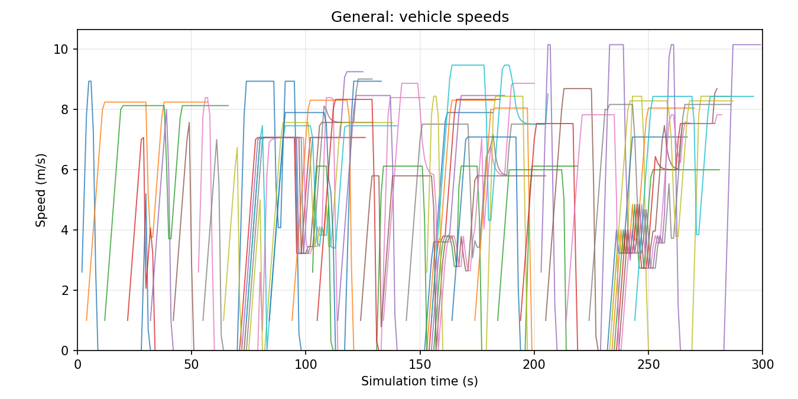
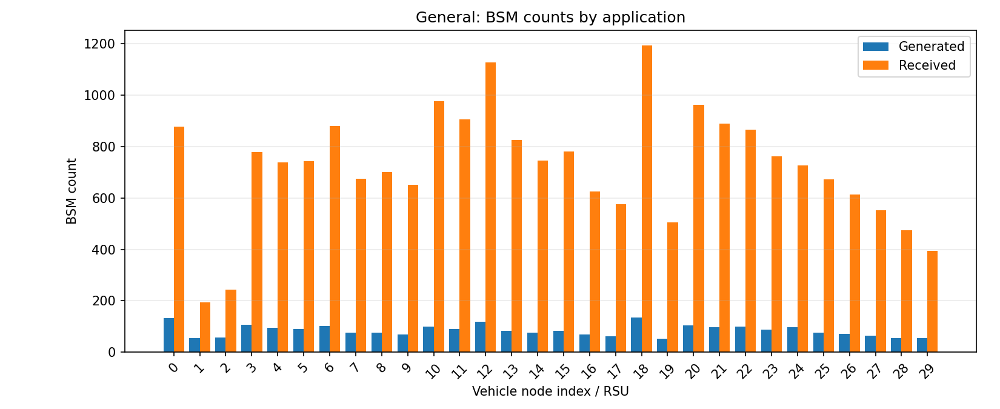
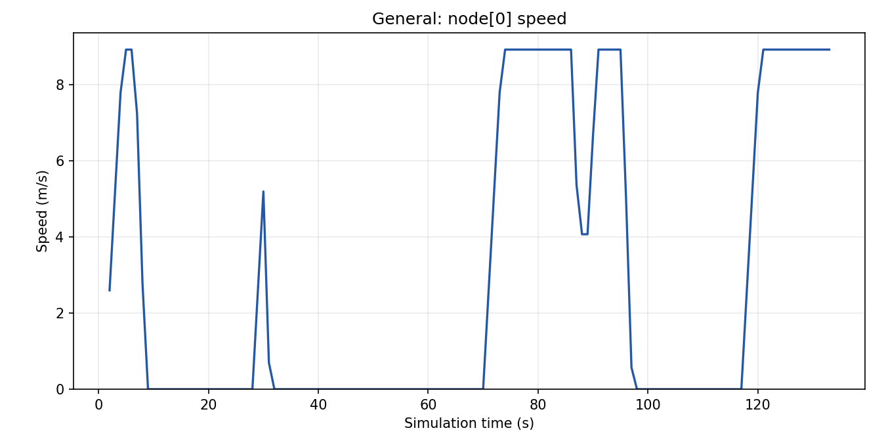

**AI 使用声明：在 ChatGPT 的协助下理解了核心源文件，并在 Codex 的协助下使代码兼容 Linux。**

学生：WU Dihang     
学号：26040407g

本实验参考了教程 PDF，但在课堂上完成实验后，将环境从 Windows 替换为 Linux，并做了少量修改。

## 开发环境

| 工具 | 版本 | 本地路径 |
|---|---|---|
| sumo | 1.22.0 | `/home/maple/sumo-1.22.0/bin/sumo` |
| sumo-gui | 1.22.0 | `/home/maple/sumo-1.22.0/bin/sumo-gui` |
| netconvert | 1.22.0 | `/home/maple/sumo-1.22.0/bin/netconvert` |
| omnetpp | 6.1 | `/home/maple/omnetpp-6.1/bin/omnetpp` |
| veins_launchd | 5.3.1  | `/home/maple/veins-5.3.1/bin/veins_launchd` |
| veins_run | 5.3.1  | `/home/maple/veins-5.3.1/bin/veins_run` |
| make(GNU) | 4.3 | `/usr/bin/make` |
| clang | 18.1.3 | `/usr/bin/clang` |
| python3 | 3.12.3 | `/usr/bin/python3` |


## Lab1
Lab1 模拟了一个 SUMO 道路交通场景，包括：
* 道路网络：两个节点之间的一条双向道路，每个方向有两条机动车道，并设有人行道和人行横道。
* 公交站：两个公交站，公交车在每站停留 20 秒。
* 车辆生成：5 辆公交车和 25 辆 NPC 小汽车，小汽车以 10 秒的间隔分批进入道路。
* 路线配置：车辆沿预定义的路线行驶，并表现出加速、减速、公交站停车和跟车等交通行为。
* 道路网络使用 netconvert 生成，仿真在 SUMO 中运行 300 秒的仿真时间。可以通过 sumo-gui 观察车辆运动。

### 工程文件

| 工程文件 | 功能 |
|---|---|
| `lab1.nod.xml` | 定义道路节点及其坐标。 |
| `lab1.edg.xml` | 定义道路、车道数量、限速、人行道和环岛声明。 |
| `lab1.conn.xml` | 定义人行横道及其优先权。 |
| `lab1.net.xml` | 存储由 `netconvert` 自动生成的完整道路网络。 |
| `lab1.add.xml` | 定义公交站及其在车道上的位置。 |
| `lab1.rou.xml` | 定义车辆类型、路线、出发计划、交通流和停车时长。 |
| `lab1.sumo.cfg` | 指定仿真输入文件、开始和结束时间以及日志设置。 |
| `lab1.sumo_gui_settings.xml` | 为 SUMO GUI 选择 `real world` 可视化方案。 |

#### `lab1.nod.xml`
* 这是一个描述（道路的）2 个节点的配置文件
    ```xml
    <nodes>
        <node id="1" x="-150.0" y="0.0" />
        <node id="2" x="+50.0" y="0.0" />
    </nodes>
    ```
    * `id` `1` 和 `2`：分别为 2 个节点的名称
    *  `x`,`y`：2 个节点的坐标

#### `lab1.edg.xml`
* 此配置文件描述连接节点的道路。
    ```xml
    <edges>
        <edge from="1" id="1to2" to="2" numLanes="2" speed="16.667" sidewalkWidth="1"/>
        <edge from="2" id="2to1" to="1" numLanes="2" speed="16.667" sidewalkWidth="1"/>

        <roundabout edges="1to2 2to1"/>
        <roundabout edges="2to1 1to2"/>
    </edges>
    ```
    * `"1to2"` 和 `"2to1"`：分别命名 2 个方向的 2 条道路
    * `numLanes="2"`：每条道路有 2 条车道
    * `speed="16.667"`：这 2 条道路的限速均为 16.667 m/s
    * `sidewalkWidth="1"`：添加宽度为 2m 的人行道
    * `<roundabout edges="1to2 2to1"/>`：将 `"edges"` 定义为环岛
        * 两个环岛定义是重复的；可以删除其中一个。

#### `lab1.conn.xml`
* 此配置文件描述横跨道路的人行横道
    ```xml
        <connections>
            <crossing node="2" edges="1to2 2to1" priority="true" width="1"/>
        </connections>
    ```
    * `node="2"`：节点处有一条人行横道，它连接 2 个方向的 2 条道路
    * `edges="1to2 2to1"`：横跨这 2 条道路
    * `priority="true"`：给予行人优先权
    * `width="1"` = 1m


#### `lab1.net.xml`
* 这是由 `netconvert` 根据 `lab1.nod.xml`、`lab1.edg.xml` 和 `lab1.conn.xml` 生成的完整道路网络文件，包含这 3 个配置文件的信息，可由 SUMO 直接加载。
    ```shell
    cd Lab1
    netconvert --node-files=lab1.nod.xml --edge-files=lab1.edg.xml --connection-files=lab1.conn.xml --output-file=lab1.net.xml
    ```

#### `lab1.add.xml`
* 此配置文件描述两个公交站的位置。
    ```xml
    <additional>
        <busStop id="1" lane="1to2_1" startPos="33.57" endPos="53.57" lines="1_1"/>
        <busStop id="2" lane="2to1_1" startPos="39.58" endPos="59.58" lines="1_2"/>
    </additional>
    ```
    * `id`：每个公交站的名称。
    * `lane`：公交站所在的车道，两个站点分别位于道路的相反方向。
    * `startPos` 和 `endPos`：站点区域的起点和终点，从车道起点沿车道以米为单位测量。
        * 站点 1 从 33.57m 延伸到 53.57m，站点 2 从 39.58m 延伸到 59.58m。两个站点区域均长 20m。
    * `lines`：为站点显示的公交线路标签。

#### `lab1.rou.xml`
* 此配置文件定义车辆类型、路线、各辆公交车和 NPC 小汽车流。
* 第一部分定义两种车辆类型。
    ```xml
    <vType id="1" accel="2.6" decel="4.5" sigma="0" length="10" minGap="3" maxSpeed="60" color="1,1,0" guiShape="bus"/>
    <vType id="2" accel="1.0" decel="5.0" sigma="0.0" length="2.0" maxSpeed="100.0" color="1,0,0" />
    ```
    * `id="1"` 用于公交车，`id="2"` 用于 NPC 小汽车。
    * `accel`：加速度参数，单位为 m/s²。公交车为 2.6，NPC 小汽车为 1.0。
    * `decel`：正常减速度参数，单位为 m/s²。公交车为 4.5，NPC 小汽车为 5.0。
    * `sigma="0"`：将默认跟车模型的驾驶员不完美性参数设为零。 
    * `length`：车辆长度，单位为米。公交车长 10m，NPC 小汽车长 2m。
    * `minGap="3"`：将公交车静止时的最小间距设为 3m。
    * `maxSpeed`：车辆自身的最大速度参数，单位为 m/s。数值 60 和 100 不是车辆必须保持的速度。 
    * `color="1,1,0"` 表示黄色，而 `color="1,0,0"` 表示红色。 
    * `guiShape="bus"`：使用公交车形状显示车辆。

* 下一部分定义公交车的共用路线。
    ```xml
    <route id="route0" edges="1to2 2to1">
        <stop busStop="1" duration="20"/>
        <stop busStop="2" duration="20"/>
    </route>
    ```
    * `id="route0"`：公交车引用此路线时使用的名称。
    * `edges="1to2 2to1"`：先从节点 1 行驶到节点 2，再从节点 2 返回节点 1。
    * `busStop="1"` 和 `busStop="2"` 引用 `lab1.add.xml` 中定义的站点。
    * `duration="20"`：在每个公交站停留 20 秒的仿真时间。
    * 车辆完成路线后离开仿真。环岛声明不会使路线无限重复。

* 五辆公交车由 `Lab1/lab1.rou.xml` 中的以下 `vehicle` 元素定义：

    ```xml
    <vehicle id="KMB_1" color="1,1,0" route="route0" depart="0" type="1"/>
    <vehicle id="KMB_2" color="1,1,0" route="route0" depart="51" type="1"/>
    <vehicle id="KMB_3" color="1,1,0" route="route0" depart="101" type="1"/>
    <vehicle id="KMB_4" color="1,1,0" route="route0" depart="151" type="1"/>
    <vehicle id="KMB_5" color="1,1,0" route="route0" depart="201" type="1"/>
    ```

    * `id`：标识每辆公交车，从 `KMB_1` 到 `KMB_5`。
    * `route="route0"`：使用共用的公交路线及其停车指令。
    * `depart`：指定计划出发时间，以仿真秒为单位。
    * `type="1"`：使用车辆类型 1 的参数。

* NPC 小汽车由从同一源文件中提取的以下五个 `flow` 元素生成：

    ```xml
    <flow id="car_route" color="1,0,0"  begin="0" end="50" period="10" type="2">
        <route edges="1to2 2to1"/>
    </flow>
    <flow id="car_route1" color="1,0,0" begin="52" end= "100" period="10" type="2">
        <route edges="1to2 2to1"/>
    </flow>
    <flow id="car_route2" color="1,0,0" begin="102" end="150" period="10" type="2">
        <route edges="1to2 2to1"/>
    </flow>
    <flow id="car_route3" color="1,0,0" begin="152" end="200" period="10" type="2">
        <route edges="1to2 2to1"/>
    </flow>
    <flow id="car_route4" color="1,0,0" begin="202" end="250" period="10" type="2">
        <route edges="1to2 2to1"/>
    </flow>
    ```

    * `begin`：每个交通流中第一辆小汽车的计划出发时间。
    * `end`：出发时间区间的终点；不包含该时刻。
    * `period="10"`：在该区间内每 10 秒安排一辆小汽车。
    * `type="2"`：使用 NPC 小汽车类型。
    * 每个交通流都包含自己的 `<route edges="1to2 2to1"/>`。小汽车沿道路的两个方向行驶，不包含公交车的停车指令。
    * 例如，`car_route` 的设置为 `begin="0"`、`end="50"` 和 `period="10"`，因此其计划出发时间为 0、10、20、30 和 40 秒。

* 五个 `vehicle` 元素创建 5 辆公交车。五个 `flow` 元素中的每一个安排 5 辆 NPC 小汽车，共计 25 辆 NPC 小汽车和 30 辆车。如果没有足够空间安全插入车辆，计划出发可能会延迟。

#### `lab1.sumo.cfg`
* 这是 SUMO 启动时加载的主配置文件。
    ```xml
    <configuration>
        <input>
            <net-file value="lab1.net.xml"/>
            <route-files value="lab1.rou.xml"/>
            <additional-files value="lab1.add.xml"/>
        </input>
        <time>
            <begin value="0"/>
            <end value="300"/>
        </time>
        <report>
            <no-step-log value="true"/>
        </report>
    </configuration>
    ```
    * `net-file`：加载生成的道路网络。
    * `route-files`：加载车辆类型、路线和出发计划。
    * `additional-files`：加载公交站。
    * 相对输入路径从包含此配置文件的目录解析，即 `Lab1/`。
    * `begin="0"` 和 `end="300"`：从仿真时间 0s 运行到 300s。这与现实世界中等待所花费的时间不同。
    * `no-step-log="true"`：抑制终端中常规的逐步进度消息。

#### `lab1.sumo_gui_settings.xml`
* 这是一个额外的显示配置
    ```xml
    <viewsettings>
        <scheme name="real world"/>
    </viewsettings>
    ```
    * `real world` 方案改变道路、车辆和背景的外观。
    * 它不会使仿真时间等于现实时间，也不会改变交通模型。
    * 此文件由 `Lab1/Makefile` 中的 `--gui-settings-file` 参数加载。

### 在 Linux 上运行 Lab1

从工程根目录运行。要在 SUMO GUI 中观察交通：

```shell
make -C Lab1 lab1-sumo-gui
```

点击 SUMO 运行按钮以开始。此命令会在需要时自动生成道路网络。要在没有图形窗口的情况下运行，改用 `make -C Lab1 lab1-sumo`。只想生成或更新路网时，使用 `make -C Lab1 lab1-netconvert`。

* Makefile 使用的 GUI 命令为：
    ```shell
    cd Lab1
    sumo-gui -c lab1.sumo.cfg --gui-settings-file lab1.sumo_gui_settings.xml --delay 100
    ```
    * `-c`：指定主仿真配置。
    * `--gui-settings-file`：指定显示配置。
    * `--delay 100`：在仿真步之间添加 100ms 的延迟，使车辆运动更容易观察。
* 执行顺序为：生成或复用路网，加载仿真配置及其输入，按照计划插入车辆，更新车辆运动和停车状态，并在配置的仿真结束时间结束。

### Lab1 截图


## Lab2

Lab2 使用 OMNeT++、Veins 和 Lab1 的 SUMO 道路交通模拟一个车辆通信场景，包括：
* 通信网络：一个名为 `hello` 的网络，包含由 Veins 管理的车辆节点和一个路侧单元（RSU）。
* 交通同步：OMNeT++ 通过 TraCI 与 SUMO 通信，以分发车辆的位置和运动。
* 无线通信：车辆和 RSU 使用 IEEE 802.11p PHY 和 IEEE 1609.4 MAC 模型，并周期性发送基本安全消息（BSM）。
* 事故：指示一辆公交车在 75s（仿真时间）停车以模拟事故。
* 仿真：仿真最多运行 300 秒的仿真时间，并为信道切换提供单独的配置（默认 `General` 不进行信道切换）。

### 工程文件

| 工程文件 | 功能 |
|---|---|
| `Lab2/core/package.ned` | 定义 NED（网络描述）包的名称。 |
| `Lab2/core/lab2.ned` | 定义名为 `hello` 的网络，并向 Veins 场景添加一个 RSU。 |
| `Lab2/core/omnetpp.ini` | 定义 OMNeT++ 仿真和车载通信设置。 |
| `Lab2/core/lab2.launchd.xml` | 声明启动交通仿真时使用的 SUMO 文件路径。 |
| `Lab2/core/config.xml` | 定义通信模型。 |
| `support/` | 用于在 Linux 环境中运行 Lab2 的额外辅助源文件。 |

#### `package.ned`
* 此文件定义 NED 文件使用的包名。
    ```ned
    package org.car2x.veins;
    ```
    * `package`：声明 NED 的包名。
    * `org.car2x.veins`：网络的包名。它也用于 `omnetpp.ini` 中。

#### `lab2.ned`
* 此文件通过继承现有的 Veins 场景来定义仿真网络。
    ```ned
    package org.car2x.veins;

    import org.car2x.veins.nodes.RSU;
    import org.car2x.veins.nodes.Scenario;

    network hello extends Scenario
    {
        submodules:
            rsu[1]: RSU
            {
                @display("p=150,140;i=veins/sign/yellowdiamond;is=vs;r=500");
            }
    }
    ```
    * `import xxx`：使现有模块 `RSU` 和 `Scenario` 的类型可供此文件使用。
    * `network hello extends Scenario`：从 Veins 命名一个网络 `hello` 并继承其要素，完整名称为 `org.car2x.veins.hello`。
    * `submodules`：添加此网络中包含的子模块。
    * `rsu[1]: RSU`：创建一个包含 1 个 RSU 的 RSU 数组（索引为 `rsu[0]`）
    * `@display`：配置 RSU 在 OMNeT++ 中的显示方式
        * `p=150,140`：RSU 图标的坐标位置。
        * `i=veins/sign/yellowdiamond` 和 `is=vs`：设置图标及其大小。
        * `r=500`：绘制一个半径为 500 的无线通信范围圆。
    * 实际 RSU 坐标在 `omnetpp.ini` 中定义。

#### `omnetpp.ini`
* 这是 OMNeT++ 的主配置文件
* 第一部分选择网络并配置终端进度消息。
    ```ini
    [General]
    cmdenv-express-mode = true
    cmdenv-autoflush = true
    cmdenv-status-frequency = 1s
    **.cmdenv-log-level = info

    network = org.car2x.veins.hello
    ```
    * `[General]`：定义 omnetpp 的通用（一般）设置。
    * `cmdenv-express-mode = true`：在命令行仿真中通过快速模式减少详细输出。
    * `cmdenv-autoflush = true`：自动刷新命令行输出。
    * `cmdenv-status-frequency = 1s`：每 1 秒（仿真时间）更新状态。
    * `**.cmdenv-log-level = info`：设置 `log` 级别 = info
    * `network`：选择 `lab2.ned` 中声明的网络

* `Simulation parameters` 部分定义仿真时长、结果记录和 omnetpp 的仿真区域尺寸。
    ```ini
    debug-on-errors = false
    print-undisposed = false
    sim-time-limit = 300s

    **.scalar-recording = true
    **.vector-recording = true

    *.playgroundSizeX = 500m
    *.playgroundSizeY = 500m
    *.playgroundSizeZ = 50m
    *.annotations.draw = true
    ```
    * `debug-on-errors = false`：在发生仿真错误时，让调试器不中断。错误可能使仿真停止
    * `print-undisposed = false`：禁用仿真结束时对遗留未释放对象的报告。
    * `sim-time-limit = 300s`：将仿真时间限制为 300 秒（仿真时间）。
    * `scalar-recording`：启用结果记录，例如消息数量。
    * `vector-recording`：启用随时间变化的结果记录，例如不同仿真时刻的车辆速度。
    * `playgroundSizeX`、`playgroundSizeY` 和 `playgroundSizeZ`：将 Omnetpp 的仿真区域尺寸定义为经度=500m、宽度=500m 和高度=50m。 
        * 这些设置不影响 SUMO 道路。
    * `annotations.draw = true`：启用 omnetpp 中的可视化，例如两个通信节点之间的连线。

* ``TraCI` 定义 OMNeT++ 如何连接同一台计算机上的 SUMO。
    ```ini
    *.manager.updateInterval = 1s
    *.manager.host = "localhost"
    *.manager.port = 9999
    *.manager.autoShutdown = true
    *.manager.launchConfig = xmldoc("lab2.launchd.xml")
    ```
    * `updateInterval = 1s`：每 1s 同步仿真。
    * `host = "localhost"`：连接同一台计算机上的代理。
    * `port = 9999`：使用端口 9999 连接代理。
    * `autoShutdown = true`：当 SUMO 报告不再有剩余交通仿真时，允许停止仿真。
    * `launchConfig`：从 `./lab2.launchd.xml` 加载 XML 启动指令

* `RSU settings` 定义其位置和其他参数。
    ```ini
    *.rsu[0].mobility.x = 500
    *.rsu[0].mobility.y = 500
    *.rsu[0].mobility.z = 3

    *.rsu[*].applType = "TraCIDemoRSU11p"
    *.rsu[*].appl.headerLength = 80 bit
    *.rsu[*].appl.sendBeacons = true
    *.rsu[*].appl.dataOnSch = false
    *.rsu[*].appl.beaconInterval = 1s
    *.rsu[*].appl.beaconUserPriority = 7
    *.rsu[*].appl.dataUserPriority = 5
    ```
    * `rsu[0].mobility.x`、`y` 和 `z`：rsu[0] 的坐标；rsu[*] 表示作用于所有 rsu
    * `applType = "TraCIDemoRSU11p"`：使用 Veins 的 RSU 应用，它可以转发收到的交通消息。
    * `headerLength = 80 bit`：将头部长度设为 80 比特。
    * `sendBeacons = true`：启用周期性信标消息（BSM）。
    * `dataOnSch = false`：在控制信道（CCH）上发送数据，而不是服务信道（SCH）。
    * `beaconInterval = 1s`：将信标间隔设为 1 秒（仿真时间）。
    * `beaconUserPriority = 7` 和 `dataUserPriority = 5`：设置信标和数据消息的优先级。 


* `connection manager` 控制模块之间如何传递无线传输。
    ```ini
    *.connectionManager.sendDirect = true
    *.connectionManager.maxInterfDist = 2600m
    *.connectionManager.drawMaxIntfDist = false
    ```
    * `sendDirect = true`：允许在仿真模块之间直接传输消息。
    * `maxInterfDist = 2600m`：设置最大干扰距离
    * `drawMaxIntfDist = false`：不在 GUI 中绘制最大干扰距离。


* `IEEE 1609.4 MAC` 定义信道使用、发射功率和比特率。
    ```ini
    *.**.nic.mac1609_4.useServiceChannel = false
    *.**.nic.mac1609_4.txPower = 20mW
    *.**.nic.mac1609_4.bitrate = 6Mbps
    ```
    * `useServiceChannel = false`：禁用控制信道与服务信道之间的切换
    * `txPower = 20mW`：将无线电发射功率设为 2000 万瓦。
    * `bitrate = 6Mbps`：将传输比特率设为每秒 6 兆比特。
    * `*.**.nic`：将这些设置应用于所有通信单元（车辆和 RSU）。


* `IEEE 802.11p PHY` 定义背景噪声、无线电模型。
    ```ini
    *.**.nic.phy80211p.minPowerLevel = -89dBm
    *.**.nic.phy80211p.useNoiseFloor = true
    *.**.nic.phy80211p.noiseFloor = -110dBm
    *.**.nic.phy80211p.decider = xmldoc("config.xml")
    *.**.nic.phy80211p.analogueModels = xmldoc("config.xml")
    *.**.nic.phy80211p.usePropagationDelay = true
    ```
    * `minPowerLevel = -89dBm`：设置 PHY 接收模型使用的最小接收功率。 
    * `useNoiseFloor = true` 和 `noiseFloor = -110dBm`：启用 -110dBm 的背景噪声。
    * `decider`：从 `config.xml` 获取接收判决模型
    * `analogueModels`：从 `config.xml` 获取信号传播模型
    * `usePropagationDelay = true`：考虑无线电信号在节点之间所需的时间。

* `vehicle application` 启用 Veins 演示应用和周期性信标。
    ```ini
    *.node[*].applType = "TraCIDemo11p"
    *.node[*].appl.headerLength = 80 bit
    *.node[*].appl.sendBeacons = true
    *.node[*].appl.dataOnSch = false
    *.node[*].appl.beaconInterval = 1s
    ```
    * `node[*]`：将设置应用于所有创建的车辆节点。
    * `applType = "TraCIDemo11p"`：当车辆持续停止时生成交通警告。
    * `headerLength = 80 bit`：将头部长度设为 80 比特。
    * `sendBeacons = true` 和 `beaconInterval = 1s`：启用标称间隔为一秒的 BSM。
    * `beaconInterval = 1s`：将信标间隔设为 1 秒（仿真时间）。

* `mobility settings` 选择车辆移动性模块并配置计划事故。
    ```ini
    *.node[*].veinsmobilityType = "Lab2TraCIMobility"
    *.node[*].veinsmobility.x = 0
    *.node[*].veinsmobility.y = 0
    *.node[*].veinsmobility.z = 1.895
    *.node[*0].veinsmobility.accidentCount = 1
    *.node[*0].veinsmobility.accidentStart = 75s
    *.node[*0].veinsmobility.accidentDuration = 50s
    ```
    * `veinsmobilityType = "Lab2TraCIMobility"`：使用本地 Lab2TraCIMobility 作为 veinsmobilityType
        * Lab2TraCIMobility 在 support/ 中定义
    * `x = 0` 和 `y = 0`：初始值，实际车辆位置由 SUMO 通过 TraCI 更新。
    * `z = 1.895`：将车辆移动性高度设为 1.895m。
    * `node[*0]`：匹配以 `0` 结尾的车辆索引，例如 `node[0]`、`node[10]` 和 `node[20]`。
    * `accidentCount = 1`：为每辆匹配的车辆安排一次事故。
    * `accidentStart = 75s`：安排事故开始的时间
    * `accidentDuration = 50s`：安排事故的持续时间

* 最后一部分定义启用信道切换的另一种配置。
    ```ini
    [Config WithChannelSwitching]
    *.**.nic.mac1609_4.useServiceChannel = true
    *.node[*].appl.dataOnSch = true
    *.rsu[*].appl.dataOnSch = true
    ```
    * `[Config WithChannelSwitching]`：创建一个名为 'WithChannelSwitching' 的配置，继承 `[General]` 中的通用设置。
    * `useServiceChannel = true`：启用 MAC 在控制信道与服务信道之间的切换。
    * `dataOnSch = true`：在服务信道上发送车辆和 RSU 的应用数据。信标仍保留在控制信道上。
    * 其他仿真、交通和无线电设置保持不变，继承自 `[General]`。

#### `lab2.launchd.xml`
* 此文件指定 SUMO 配置文件的路径。
    ```xml
    <launch>
        <basedir path="../../Lab1"/>
        <copy file="lab1.net.xml"/>
        <copy file="lab1.rou.xml"/>
        <copy file="lab1.add.xml"/>
        <copy file="lab1.sumo.cfg" type="config"/>
    </launch>
    ```
    * `<launch>`：参数关键字，表示此部分被发送到 SUMO 代理以进行启动。
    * `basedir`：文件的基本路径
    * `<copy>`：将每个所需文件复制到用于 SUMO 的临时目录。
    * `lab1.net.xml` `lab1.rou.xml` `lab1.add.xml`：从 Lab1 复用的道路配置文件
    * `lab1.sumo.cfg` 和 `type="config"`：指示主 SUMO 配置文件。
    * Lab2 复用 Lab1 的交通输入，而不是定义一个新的道路网络。

#### `config.xml`
* 此文件定义 `omnetpp.ini` 引用的无线电传播和接收模型。
    ```xml
    <root>
        <AnalogueModels>
            <AnalogueModel type="SimplePathlossModel">
                <parameter name="alpha" type="double" value="2.0"/>
            </AnalogueModel>
        </AnalogueModels>
        <Decider type="Decider80211p">
            <!-- The center frequency on which the phy listens -->
            <parameter name="centerFrequency" type="double" value="5.890e9"/>
        </Decider>
    </root>
    ```
    * `<root>`：omnet 的关键字
    * `<AnalogueModels>`：应用于发射无线电信号的模型。
    * `type="SimplePathlossModel"`：使用基于距离的信号衰减模型。
    * `alpha`：路径损耗指数。当 `value="2.0"` 时，接收功率大致随距离的平方而减小
    * `type="double"`：将参数值解释为双精度浮点数。
    * `<Decider type="Decider80211p">`：选择判决器类型
    * `centerFrequency = 5.890e9`：将监听中心频率设为 58.90 亿赫兹（5.89GHz）。

#### `support/`

| 文件或目录 | 功能 |
|---|---|
| `compat/` | 存放用于在本机 Veins 和 OMNeT++ 版本下记录车辆数据的兼容性代码。 |
| `.cproject` | OMNeT++ IDE 使用的 C/C++ 工程设置。 |
| `.nedfolders` | 指定 IDE 的工程 NED 源文件目录。 |
| `.oppbuildspec` | 配置 IDE 使用自定义 Makefile 进行构建。 |
| `.project` | 定义 IDE 工程、其 Veins 依赖，以及指向其他 Lab2 目录的链接。 |
| `commands.mk` | 提供编译、启动 SUMO 代理、运行 OMNeT++ 和导出图表的命令。 |
| `lab2.anf` | 定义结果输入，以及用于绘制车辆速度和消息数量的 Python 脚本。 |
| `lab2.launch` | 定义 OMNeT++ IDE 的仿真启动设置。 |
| `Makefile` | 提供 IDE 构建入口，并调用 `commands.mk` 中的构建目标。 |
| `prepare_ned.py` | 在 `Lab2/out/` 下准备合并的 NED 目录，避免加载课程网络和 Veins 时出现重复包定义。 |

### 在 Linux 上运行 Lab2

在工程根目录打开两个终端：

```shell
cd ~/Desktop/EIE575_Lab
```

* 在终端 1 中启动 SUMO GUI 的代理，并保持其运行：
    ```shell
    make -C Lab2/support -f commands.mk lab2-veins-launchd-sumo-gui
    ```
    * `-C Lab2/support`：在 support 目录中运行 make。
    * `-f commands.mk`：使用此文件中定义的 Lab2 构建和运行命令。
    * 等待出现 `Listening on port 9999`。当 OMNeT++ 连接代理时，SUMO GUI 会打开。
    * 此命令加载 `Lab1/lab1.sumo_gui_settings.xml`，使用与 Lab1 相同的 `real world` 可视化方案，显示车辆形状而不是默认三角形。
    * `--delay 100`：在 SUMO 仿真步之间添加 100ms 的延迟，与 Lab1 一致。
* 在终端 2 中构建工程并打开 OMNeT++ 仿真窗口：
    ```shell
    make -C Lab2/support -f commands.mk lab2-omnetpp-qtenv
    ```
    * 此命令会在需要时自动生成 Lab1 路网，检查 NED 文件，并构建 Lab2 兼容性库。
    * 使用 `General` 配置，并在 OMNeT++ 中点击 **运行** 或 **快速** 以开始仿真。SUMO 通过 TraCI 与 OMNeT++ 一起推进。
    * 仿真结果写入 `Lab2/results/`。
* 要选择信道切换配置，在终端 2 中改用以下命令：
    ```shell
    make -C Lab2/support -f commands.mk lab2-omnetpp-qtenv LAB2_CONFIG=WithChannelSwitching
    ```
* 要在没有图形窗口的情况下运行，在终端 1 中使用 `lab2-veins-launchd-sumo`，在终端 2 中使用 `lab2-omnetpp-cmdenv`。
* 完成后，关闭仿真窗口，并在终端 1 中按 **Ctrl+C** 停止代理。每次只能有一个代理使用端口 9999。如果端口已被占用，在启动另一个代理前停止之前的代理。
* 如果在更新显示设置之前已有 SUMO 代理运行，请使用上述命令重启它，并开始一次新的仿真运行以应用显示设置。

### Lab2 截图


##  仿真结果分析
### 根据 node[0] 速度图进行分析
| 时间 | 速度变化 | 可能的实际原因 |
|---|---|---|
| 约 2–6 s | 从约 2.5 m/s 加速到 10 m/s | 公交车进入道路并开始加速。 |
| 约 6–10 s | 减速到 0 m/s | 公交车到达第一个公交站。 |
| 约 10–28 s | 保持 0 m/s | 公交车在第一个公交站停留了约 20 秒。 |
| 约 28–36 s | 从 0 加速到约 19 m/s | 公交车离开第一个站点并加速。 |
| 约 36–42 s | 减速到约 4 m/s，然后再次加速 | 公交车在道路末端掉头。 |
| 约 46–50 s | 减速到 0 m/s | 公交车接近第二个公交站。 |
| 约 50–69 s | 保持 0 m/s | 公交车在第二个公交站停留了约 20 秒。 |
| 约 69–75 s | 加速到约 16 m/s | 公交车离开第二个公交站。 |
| 约 75–79 s | 快速减速到 0 m/s | 计划事故被触发。 |
| 约 79–126 s | 保持 0 m/s | 公交车在事故期间保持停车。 |
| 约 126–130 s | 再次加速 | 事故结束。 |
### 根据 BSM 数量图进行分析
* 车辆 0,6,12,18,24 接收和发送的消息比其他车辆更多，因为它们是速度较低的公交车，因此在仿真中停留的时间更长
* 车辆0 接收和发送的消息比其他公交车更多，因为它发生了事故，所以在仿真中停留的时间比其他公交车更长。

##  修改参数
* 最大限速参数从 16.667 改为 8 m/s
* 计划事故开始时间从 75 s 改为 30 s，持续时间从 50s 缩短为 40s
* 输出图表呈现出很大的差异





